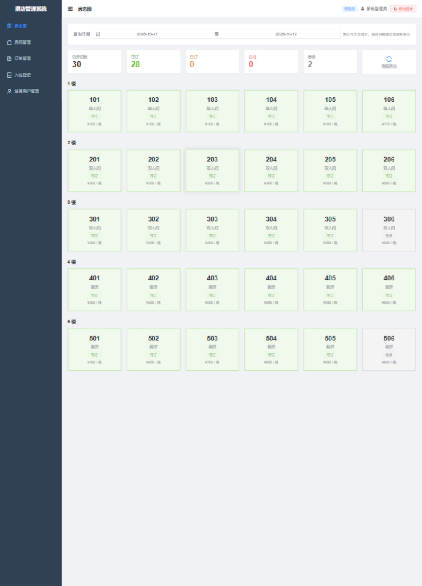
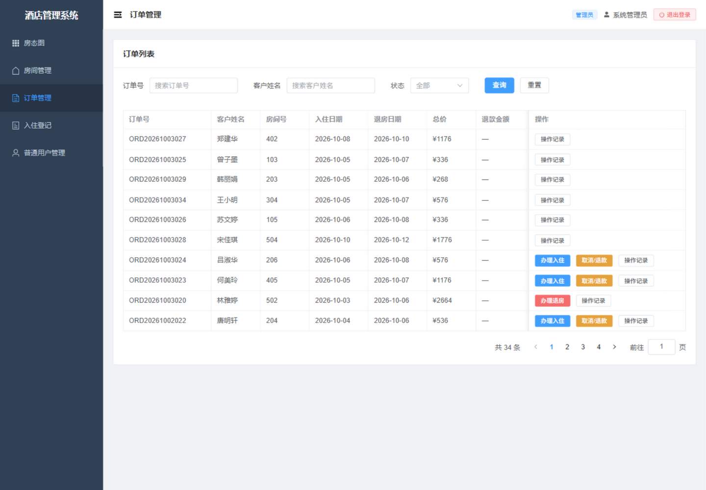
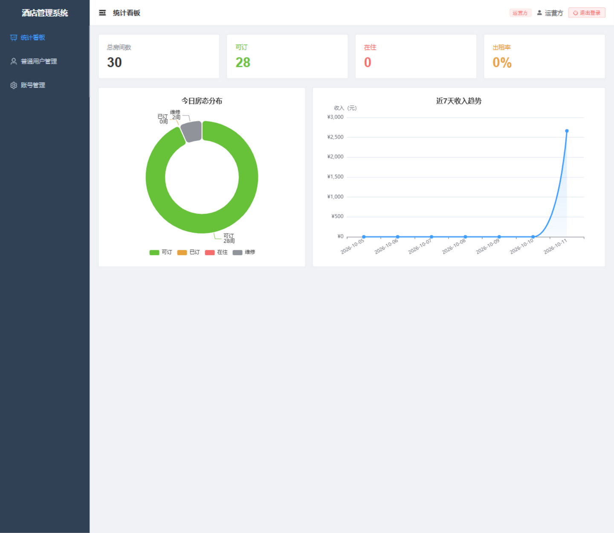
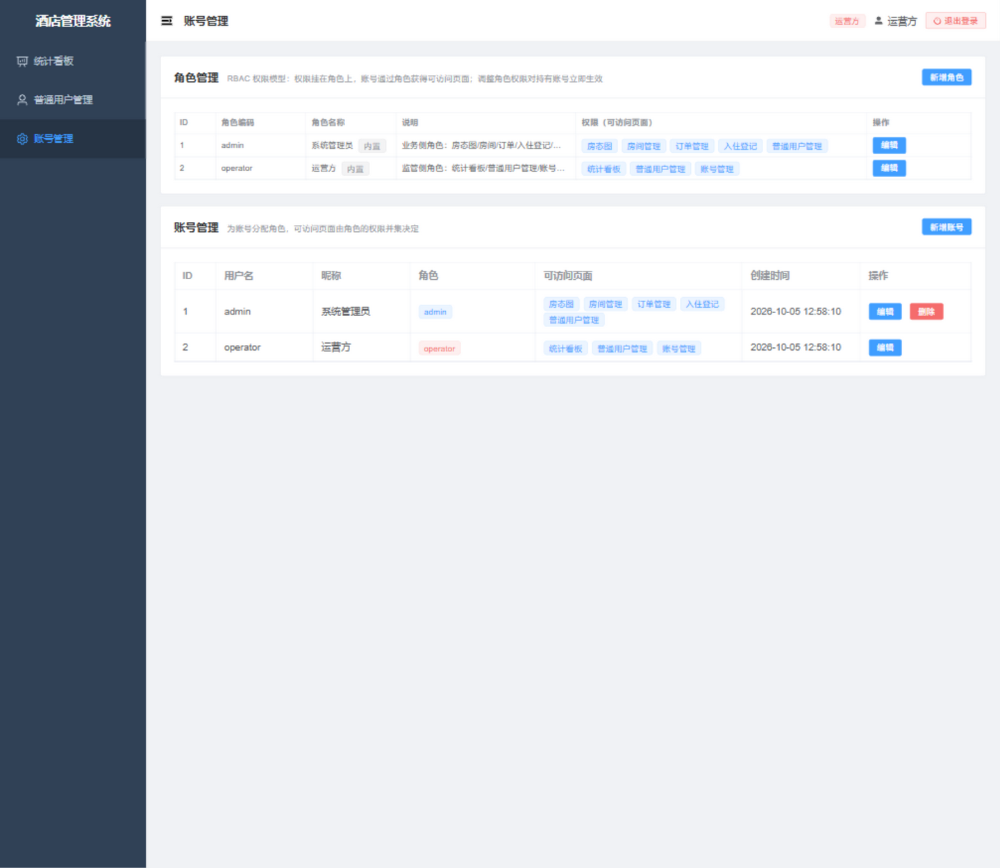

# 酒店客房预订管理系统

基于 Spring Boot 3 + Vue 3 的前后端分离酒店客房预订管理系统，覆盖 RBAC 权限、订单全生命周期、防超卖、缓存与会话、数据可视化等后端核心场景。

      

## 功能特性

**业务功能**

- 房态图：按入住/退房日期区间实时推导可订/已订/在住/维修状态
- 预订全流程：客人端自助注册/预订/支付/取消，管理端办理入住/退房
- 订单状态机：待支付 → 已支付 → 已入住 → 已退房 / 已取消，每次流转写入 `t_order_log` 留痕
- 超时未支付订单由定时任务自动取消，30 分钟占位后释放房源
- 退款规则：距入住日满 1 天取消全额退款，入住当天取消扣除首晚房费
- 统计看板：今日房态分布（饼图）+ 近 7 天营收趋势（折线图）

**技术设计**

- **RBAC 权限体系**：用户-角色-权限三级模型（`t_user → t_user_role → t_role → t_role_permission → t_permission`），自定义 `@RequirePermission` 注解 + 双拦截器实现接口级鉴权；权限码实时联查，调整角色权限对持有账号**立即生效**；提供角色管理界面（新增/编辑角色并勾选权限）
- **防超卖**：数据库事务 + `SELECT ... FOR UPDATE` 行锁将同一房间的并发下单与支付串行化；日期区间采用左闭右开判定，相邻日期不冲突；并有重复下单回归测试兜底
- **Redis 会话**：token 带 24h TTL 与滑动续期，管理端/客人端双 token 池隔离；抽象 `TokenStore` 接口，无 Redis 环境可一键降级为内存实现
- **Redis 读缓存**：房态图、客人端房间列表、统计看板等高频读接口缓存（TTL 兜底），订单/房间写操作主动驱逐缓存；占用校验始终直查数据库，缓存不引入超卖风险
- **统一规范**：统一 `Result` 响应体、全局异常处理（内部异常脱敏，不向前端泄露 SQL/类名）、`@Valid` 参数校验、springdoc 接口文档
- **订单号生成**：序号表 + 原子自增取号，避免并发重号与时间戳撞唯一键
- **集成测试**：15 个用例基于真实 MySQL 运行（不用 Mock），覆盖防超卖、状态机、退款规则、权限越权、参数校验，`@Transactional` 自动回滚不污染数据

## 系统截图

| 房态图 | 订单管理 |
|---|---|
|  |  |

| 统计看板（ECharts） | 账号与角色管理（RBAC） |
|---|---|
|  |  |

## 技术栈

| 端 | 技术 |
|---|---|
| 后端 | Java 17 · Spring Boot 3.2.7 · MyBatis-Plus 3.5.7 · Spring Security Crypto (BCrypt) · springdoc-openapi |
| 数据存储 | MySQL 8 · Redis（Lettuce） |
| 前端 | Vue 3.5 · Vite 6 · Element Plus 2.9 · Pinia · Vue Router · Axios · ECharts 5 |

## 快速开始

### 环境要求

- JDK 17+、Node.js 18+、MySQL 8.0+
- Redis（可选，见下方「无 Redis 运行」）

### 1. 初始化数据库

```bash
mysql -u root -p --default-character-set=utf8mb4 < hotelmanagement/sql/hotel_db.sql
# 可选：灌入演示订单/客户数据（不影响登录账号）
mysql -u root -p --default-character-set=utf8mb4 < hotelmanagement/sql/answer_demo_data.sql
```

### 2. 启动后端（端口 8088）

数据库口令通过环境变量注入，代码中不含任何密码：

```bash
# Windows（永久生效，需重开终端）
setx DB_PASSWORD 你的密码

# macOS / Linux
export DB_PASSWORD=你的密码
```

```bash
cd hotelmanagement
# Windows 用 mvnw.cmd，其余用 ./mvnw
mvnw.cmd spring-boot:run
```

启动参数（IDEA 等方式运行时同理，配置 `DB_PASSWORD` 环境变量即可）。

**无 Redis 运行**：本机没有 Redis 时，把 `hotelmanagement/src/main/resources/application.yml` 里的
`hotel.token-store` 与 `hotel.cache-type` 都改为 `memory`，会话与缓存自动降级为进程内实现。

接口文档：启动后访问 <http://localhost:8088/swagger-ui.html>

### 3. 启动前端（端口 5173）

```bash
cd hotelWeb
npm install
npm run dev
```

开发环境通过 Vite 代理转发到后端（`/api` → `http://localhost:8088`），无需处理跨域。

### 4. 登录体验

| 入口 | 账号 | 说明 |
|---|---|---|
| 管理端 · 系统管理员 | `admin / admin123` | 房态图/房间/订单/入住登记/普通用户管理 |
| 管理端 · 运营方 | `operator / operator123` | 统计看板/普通用户管理/账号与角色管理 |
| 客人端 | 手机号自助注册 | 预订/支付/取消自己的订单 |

> 两种内置角色是 RBAC 的演示视角：用 operator 登录可以在「账号管理」里新增角色、勾选权限，再把账号挂到新角色上，直观感受权限边界的即时变化。

## Docker 部署（推荐）

需要 Docker Desktop（Linux 服务器则装 docker-ce 与 compose 插件）。共 4 个容器：
**Nginx**（前端托管 + gzip/30 天静态缓存 + 接口反代）→ **app**（Spring Boot）→
**MySQL** + **Redis**。Nginx 是唯一对外入口，刷新前端路由不 404；Swagger 经反代照常可访问：

```bash
# 1. 准备环境变量（.env 内 DB_PASSWORD 自己定一个，会被 mysql 容器与后端共用）
Copy-Item .env.example .env    # macOS/Linux 用 cp

# 2. 构建并启动（首次会拉取 node/maven/jre/mysql/redis/nginx 镜像，稍久）
docker compose up -d --build

# 3. 访问
# 浏览器打开 http://localhost，账号 admin / admin123
# Swagger 地址：http://localhost/swagger-ui.html
```

常用命令：

```bash
docker compose logs -f app      # 跟踪后端日志
docker compose logs -f nginx    # 跟踪 Nginx 访问日志
docker compose down             # 停止（数据保留在 mysql-data / redis-data 卷中）
docker compose down -v          # 停止并清空数据库数据（下次启动会重新执行 sql 初始化）
docker compose up -d --build    # 代码更新后重建
```

 MySQL 与 Redis 不对外暴露端口，仅容器内网络互通；后端调试端口与
mysql 3306 端口映射见 docker-compose.yml 中的注释。

## 项目结构

```
├── hotelmanagement/              # 后端（Spring Boot 3）
│   ├── sql/                      # 建表脚本 / 演示数据 
│   └── src/main/java/com/hotel/hotelmanagement/
│       ├── annotation/           # @RequirePermission 权限注解
│       ├── interceptor/          # 登录校验 / 权限校验（RBAC）拦截器
│       ├── controller/           # 用户 / 角色 / 房间 / 订单 / 客户 / 入住 / 统计接口
│       ├── service/              # 订单状态机 / 防超卖 / 退款规则 / 统计聚合
│       ├── mapper/               # MyBatis-Plus Mapper（含 RBAC 权限联查）
│       ├── common/               # 统一 Result / 全局异常处理
│       ├── config/               # 缓存 / CORS / 分页插件 / OpenAPI
│       └── util/                 # TokenStore（Redis / 内存双实现）
└── hotelWeb/                     # 前端（Vue 3 + Vite）
    └── src/
        ├── views/                # 管理端页面（房态图/订单/看板/账号角色）+ 客人端页面
        ├── router/               # 路由守卫（按权限码控制页面访问）
        ├── stores/               # 登录态（Pinia）
        ├── api/  utils/          # 接口定义 / axios 封装（401/403 统一处理）
        └── constants/            # 权限码唯一来源（与 t_permission 一一对应）
```

## 核心设计说明

### RBAC 三级权限

```
t_user ──< t_user_role >── t_role ──< t_role_permission >── t_permission
```

- 权限码（如 `rooms`、`orders`）与前端页面一一对应；前端菜单与路由守卫、后端接口鉴权共用同一套码，保证「能看到的菜单」和「能调的接口」是同一标准。
- 鉴权时实时联查用户的权限码集合，因此编辑角色权限后，持有该角色的账号无需重新登录即按新权限生效（有集成测试覆盖）。
- 内置角色（admin/operator）不允许删除，仍被账号持有的角色删除会被拒绝。

### 防超卖：行锁串行化

日期区间的重叠无法用唯一键约束，创建订单与支付前都对房间行执行 `SELECT ... FOR UPDATE`，把同一房间的并发请求串行化后再做占用校验；不同房间之间互不阻塞。

占用口径：只有**已支付/已入住**的订单才占用房间，房态图也仅在支付后才显示「已订」。待支付订单不锁房，同一房间允许多笔待支付订单并存，先 pay 先得；后付的人在支付时的房态复核里被拒绝，未支付的订单超过 30 分钟由定时任务自动取消。另外，同一客户名下在途订单（待支付/已支付/已入住）数量有上限，可通过 `hotel.order.max-active-orders` 调整，防止单个客户囤房。

### 订单状态机

```
0 待支付 ──支付──> 1 已支付 ──入住──> 2 已入住 ──退房──> 3 已退房
   ├── 取消 ──> 4 已取消          └── 取消(退款) ──> 4 已取消
   └── 超时未支付，系统自动取消 ──> 4 已取消
```

每次流转校验前置状态并写入 `t_order_log`（操作人、原因、退款金额），订单轨迹可追溯。

## 运行测试

```bash
cd hotelmanagement
mvnw.cmd test    # 需要 MySQL 已初始化；Redis 不需要（测试自动降级为内存实现）
```

15 个集成测试基于真实数据库运行（行锁、区间查询、唯一键这些规则只有真库才测得出来），类上 `@Transactional` 保证用例间互不污染。

## 安全说明

- 代码与配置文件中不包含任何数据库/Redis 口令：开发环境通过 `DB_PASSWORD` 环境变量注入，生产环境（`application-prod.yml`）强制从环境变量读取、无缺省值
- 账号密码使用 BCrypt 加盐摘要存储；历史 MD5 摘要在登录成功后透明升级
- 仓库中的 `admin/admin123`、`operator/operator123` 为演示账号，仅用于本地体验

## 许可

个人学习项目，仅供学习交流使用。
